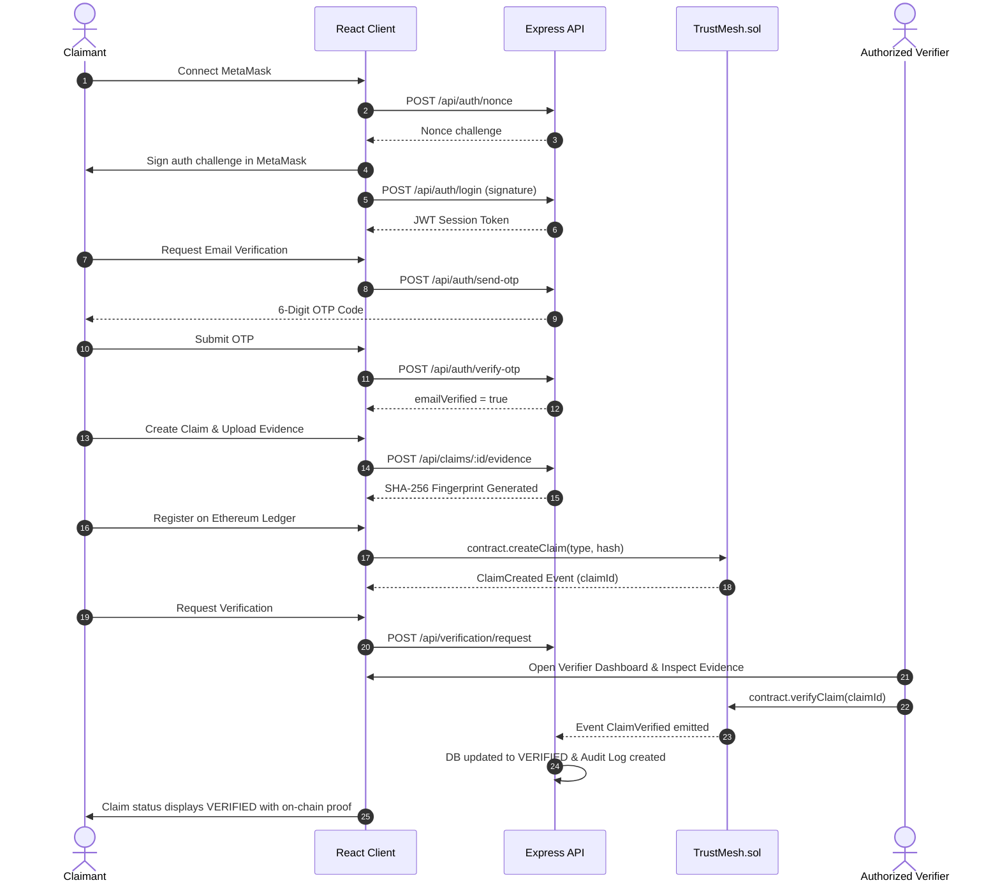

# TrustMesh — Decentralized Credential Verification & Reputation Engine

**TrustMesh** is a credential verification and decentralized trust scoring platform. It bridges off-chain professional identities with on-chain cryptographic attestations, replacing unverified resumes and LinkedIn claims with immutable, tamper-proof blockchain proofs.

---

## 1. System Architecture & Discipline

TrustMesh follows a strict **On-Chain vs. Off-Chain Separation of Concerns**:

| Layer | Technology | Primary Responsibilities |
|---|---|---|
| **Frontend (Dev A)** | React 18, Vite, TailwindCSS, Ethers.js, Zustand | Responsive Web3 dApp, MetaMask signing modals, OTP modal, inline evidence preview, dual-panel proof viewers, dynamic claim stepper. |
| **Backend (Dev B)** | Node.js, Express, MongoDB (Mongoose), Nodemailer, Multer | Wallet signature challenge (nonce/JWT), document validation, SHA-256 hashing, OTP email verification, Verification Engine rules, trust scoring calculation. |
| **Blockchain (Dev C)** | Solidity `^0.8.20`, Hardhat, Ganache, Ethers.js | Immutable registry contract (`TrustMesh.sol`), verifier access control, on-chain event emission, and real-time backend synchronization (`web3Listener.js`). |

### Architectural Flowchart

```
                          +------------------------------------------+
                          |         Frontend (React + Vite)          |
                          +---------------------+--------------------+
                                                |
                             REST API Requests  |  MetaMask Web3 Transactions
                                                v
                          +---------------------+--------------------+
                          |    TrustMesh Express Backend Server      |
                          |          (Node.js + Mongoose)            |
                          |                                          |
                          |  - Wallet Authentication (Ethers / JWT)  |
                          |  - Profiles, Claims & Evidence Storage   |
                          |  - SHA-256 Hashing & MIME-Type Check     |
                          |  - OTP Verification (Nodemailer / Dev)   |
                          |  - Verification Engine (Rule Evaluator)  |
                          |  - Trust Score Service (0-100 Weighted)  |
                          |  - Web3 Event Listener (Ethers Provider) |
                          +----------+--------------------+----------+
                                     |                    |
                                     v                    v
                      +--------------+----+        +------+-------------------+
                      |  MongoDB Database |        |    Blockchain Core       |
                      | - Users & Nonces  |        | - TrustMesh.sol          |
                      | - Profiles        |        | - Hardhat / Ganache Node |
                      | - Claims & Audit  |        | - Immutable Events       |
                      | - OTP Records     |        |   (ClaimVerified, etc.)  |
                      +-------------------+        +--------------------------+
```

### On-Chain vs. Off-Chain Data Discipline

- **Stored On-Chain (`TrustMesh.sol`)**: Claim ID, claimant wallet address, verifier wallet address, claim category, status enum (`PENDING`, `VERIFIED`, `REJECTED`, `REVOKED`), block timestamp, and SHA-256 evidence reference hash.
- **Stored Off-Chain (MongoDB & `/uploads`)**: Full text descriptions, profile headlines/bio, education/experience arrays, profile avatar images, MIME metadata, original uploaded files, and email OTP verification tokens.

---

## 2. How the Application Works (End-to-End Workflow)

The system enforces a 7-stage credential verification lifecycle:



### 1. Cryptographic Authentication (Zero Passwords)
- When a user connects their wallet, the server issues a single-use random cryptographic nonce.
- The user signs the challenge string in MetaMask.
- The server verifies the signature using `ethers.verifyMessage`. If authentic, it returns a signed JWT containing the user's wallet address and role (`owner`, `verifier`, or `admin`).

### 2. Identity & OTP Email Verification
- Users establish their identity on the **Profile** screen.
- Clicking **Verify via OTP** triggers a 6-digit cryptographic code generation.
- The hashed code is stored in MongoDB with a 5-minute expiry and 30-second cooldown limiter.
- In local development mode, the OTP is conveniently printed directly to the server terminal:
  ```text
  [EmailService] ⚡ DEV OTP CODE: [ 482910 ] (Valid for 5 mins)
  ```
- Entering the code validates the user and marks `emailVerified = true`.

### 3. Claim Creation & SHA-256 Evidence Hashing
- Users create claims using a 3-step stepper form across 6 categories: **Skill**, **Project**, **Experience**, **Contribution**, **Achievement**, or **Recommendation**.
- Form inputs dynamically adjust based on category (e.g. Organization and Domain for Experience; GitHub and Demo URLs for Projects).
- The user uploads an evidence file (PDF, PNG, JPG; max 5MB).
- The server executes MIME/magic-byte validation and generates a cryptographic SHA-256 fingerprint.
- The user can optionally mint the claim directly to the smart contract via `contract.createClaim(claimType, evidenceHash)`.

### 4. Verification Engine Rule Assessment
To prevent self-endorsement and spam, claims must fulfill the canonical verification engine condition:
$$\text{Status} = \begin{cases} \text{VERIFIED} & \text{if } \text{email\_verified} \land \text{evidence\_valid} \land \text{verifier\_authorized} \land \text{verifier\_approved} \\ \text{REJECTED} & \text{if verifier explicitly rejects} \\ \text{VERIFICATION\_PENDING} & \text{otherwise} \end{cases}$$

### 5. Verifier Queue & Inline Evidence Preview
- Users holding the `verifier` or `admin` role access the **Verifier Queue**.
- Verifiers can expand any row to inspect the full context and view the document inside an **inline PDF / Image previewer**.
- **Approve on Chain**: Opens MetaMask and calls `contract.verifyClaim(claimId)`. The transaction is tracked via `TxStatusModal`.
- **Reject Claim**: Opens an inline rejection modal where the verifier provides an immutable rationale, recorded via `contract.rejectClaim(claimId, reason)`.

### 6. Blockchain Event Synchronization
- The backend runs `web3Listener.js`, an active Ethers event subscription.
- When `ClaimVerified` or `ClaimRejected` is mined on Ethereum, the listener catches the block event and reconciles the MongoDB record automatically, setting `status = VERIFIED` and linking the transaction hash.

### 7. Algorithmic Trust Score & Public Proof
- Trust scores are computed dynamically from verified claims using a weighted model:
  - **Base starting score**: 50 points
  - **Organization / Education verification**: +10 points
  - **Mentor / Client verification**: +8 points
  - **Peer / Project verification**: +3 points
  - **Self-Claimed (unverified)**: 0 points
  - **Anti-Collusion Dampening**: Maximum 2 full-credit claims per unique verifier; subsequent claims receive 50% credit.
  - **Score Range**: Clamped between 0 and 100 points.
- Anyone can view public claim proofs at `/claim/:id` without logging in. The screen is split into **Self-Claimed Data** and **Cryptographic Blockchain Proof**, complete with copyable SHA-256 hashes and raw on-chain event accordions.

---

## 3. Screen-by-Screen Overview

| Screen | Route | Key Features |
|---|---|---|
| **Landing Hero** | `/` | Hero value proposition, MetaMask network detection, architecture pillars, and quick navigation. |
| **Profile** | `/profile` | Name, headline, bio, repeatable **Education** rows, repeatable **Experience** rows, **Skills tag input**, and **6-Digit OTP Modal**. |
| **Create Claim** | `/claims/new` | 6 card-select types, category-specific dynamic fields, drag-and-drop evidence uploader, and on-chain minting trigger. |
| **My Claims** | `/claims` | Table view with status filter tabs (`ALL`, `VERIFIED`, `PENDING`, `DRAFT`, `REJECTED`), sort controls, and `StatusBadge` indicators. |
| **Verifier Dashboard** | `/verifier` | Pending queue, expandable rows with **inline PDF / image evidence viewer**, MetaMask `verifyClaim` flow, and reject reason modal. |
| **Claim Details & Proof** | `/claim/:id` | Publicly shareable URL for recruiters, split panels (Self-Claimed vs Blockchain Proof), copyable SHA-256 hash, and raw on-chain event inspector. |
| **Verification History** | `/history/:id` | Vertical chronological audit timeline with actor wallet addresses, timestamps, and state transitions. |
| **Trust Dashboard** | `/trust-score/:wallet` | Radial SVG reputation gauge, earned badges, source breakdown bars (`Org=10`, `Mentor=8`, `Peer=3`), and transparency notice. |
| **Admin Governance** | `/admin` | Authorize (`registerVerifier`) and revoke (`revokeVerifier`) verifier addresses on the smart contract. |

---

## 4. Smart Contract Reference (`TrustMesh.sol`)

The Solidity contract is located at [`blockchain/contracts/TrustMesh.sol`](file:///c:/1_All_stuff/College%20projects/TRUSTMESH/blockchain/contracts/TrustMesh.sol):

```solidity
enum ClaimStatus { PENDING, VERIFIED, REJECTED, REVOKED }

struct Claim {
    uint256 id;
    address claimant;
    string claimType;
    string referenceHash; // SHA-256 evidence fingerprint
    ClaimStatus status;
    address verifier;
    uint256 timestamp;
}
```

### Core Functions:
- `registerProfile()`: Records claimant wallet on-chain.
- `createClaim(string claimType, string referenceHash)`: Mints a new claim and emits `ClaimCreated`.
- `requestVerification(uint256 claimId)`: Claimant signals readiness for verification.
- `verifyClaim(uint256 claimId)`: Authorized verifier approves claim, setting status to `VERIFIED` and emitting `ClaimVerified`.
- `rejectClaim(uint256 claimId, string reason)`: Authorized verifier documents rejection reason on-chain and emits `ClaimRejected`.
- `revokeVerification(uint256 claimId)`: Authorized verifier revokes a prior verification while preserving historical audit trails.
- `registerVerifier(address verifier)` / `revokeVerifier(address verifier)`: Owner-only verifier management.

---

## 5. API Reference

All backend endpoints are accessible at `http://localhost:5000/api`:

| Route | Method | Access | Description |
|---|---|---|---|
| `/auth/nonce` | `POST` | Public | Issue cryptographic nonce for wallet address |
| `/auth/login` | `POST` | Public | Verify Ethers signature and issue signed JWT |
| `/auth/send-otp` | `POST` | Authenticated | Generate and dispatch 6-digit OTP code |
| `/auth/verify-otp` | `POST` | Authenticated | Validate OTP code and set `emailVerified=true` |
| `/profile/:wallet` | `GET` | Public | Fetch public profile, claims, and live trust score |
| `/profile` | `POST` | Authenticated | Initialize profile document |
| `/profile` | `PUT` | Authenticated | Update bio, education, skills, and experience |
| `/claims` | `GET` | Public | List claims with query filtering (`status`, `type`, `profileId`) |
| `/claims` | `POST` | Authenticated | Create a new claim record |
| `/claims/:id` | `GET` | Public | Get single claim with verification metadata |
| `/claims/:id` | `PUT` | Authenticated | Update draft claim metadata |
| `/claims/:id/evidence` | `POST` | Authenticated | Upload file (Multer), validate MIME, generate SHA-256 hash |
| `/verification/hash` | `POST` | Public | Compute SHA-256 fingerprint & duplicate lookup |
| `/verification/evidence-check` | `POST` | Authenticated | Run automated file checks & update claim status |
| `/verification/request` | `POST` | Authenticated | Move claim to `VERIFICATION_PENDING` |
| `/verification/sync` | `POST` | Verifier/Admin | Record on-chain verification transaction to audit trail |
| `/verification/history/:claimId` | `GET` | Public | Retrieve chronological verification event log |
| `/trust-score/:profileId` | `GET` | Public | Calculate live weighted reputation score (0-100) |
| `/verifiers` | `GET` | Public | List authorized verifiers |
| `/verifiers` | `POST` | Admin | Authorize verifier record |
| `/verifiers/:wallet` | `DELETE` | Admin | Revoke verifier authorization |

---

Viewed .env.example:1-12
Viewed .env.example:1-4
Viewed emailService.js:1-93
Ran command: `Test-Path server/.env; Test-Path client/.env; Test-Path blockchain/.env`
Ran command: `Get-Service -Name *mongo* -ErrorAction SilentlyContinue`
Ran command: `Get-Command mongod -ErrorAction SilentlyContinue`
Ran command: `Get-Command docker -ErrorAction SilentlyContinue`
Viewed db.js:1-14
Edited emailService.js
Created .env
Created .env
Viewed .env.example:1-4
Viewed hardhat.config.js:1-13
Viewed package.json:1-13
Created hardhat.config.js
Created package.json

Here is the complete setup guide and prerequisites you need to run TrustMesh locally from end to end:

---

## 1. Prerequisites Checklist

| Component | Status | Setup Requirement |
| :--- | :--- | :--- |
| **Node.js** | Ready | Installed (v18+) |
| **MetaMask** | Browser Extension | Must be installed in Chrome / Brave / Firefox / Edge |
| **Ethereum Node** | Included | Built-in via Hardhat node (`npm run chain`) |
| **MongoDB** | **Action Needed** | Needs a running instance (Local, Docker, or free MongoDB Atlas) |
| **Email (OTP)** | **Ready (Zero Setup)** | Outgoing OTP codes print directly to the server terminal: `⚡ DEV OTP CODE: [ 123456 ]` |

---

## 2. Set Up MongoDB (Choose One Option)

Your backend connects to `MONGO_URI` (configured in [`server/.env`](file:///c:/1_All_stuff/College%20projects/TRUSTMESH/server/.env)). Choose whichever option is easiest:

### Option A: Using Docker (Fastest if Docker Desktop is installed)
Run in PowerShell:
```powershell
docker run -d -p 27017:27017 --name trustmesh-mongo mongo:latest
```

### Option B: Free MongoDB Atlas Cloud (No local software needed)
1. Create a free database at [mongodb.com/atlas](https://www.mongodb.com/atlas).
2. Open [`server/.env`](file:///c:/1_All_stuff/College%20projects/TRUSTMESH/server/.env) and update line 2:
   ```env
   MONGO_URI=mongodb+srv://<username>:<password>@cluster.mongodb.net/trustmesh?retryWrites=true&w=majority
   ```

### Option C: Local MongoDB Community Service
If you have MongoDB Community Server installed on Windows:
```powershell
net start MongoDB
```

---

## 3. MetaMask Network Setup

To enable signing and transactions in your browser:

1. Open **MetaMask** → Click the network dropdown (top-left) → **Add Network** → **Add a network manually**.
2. Fill in the details:
   - **Network Name**: `Hardhat Localhost`
   - **RPC URL**: `http://127.0.0.1:8545`
   - **Chain ID**: `31337`
   - **Currency Symbol**: `ETH`
3. Click **Save**.

### Import Test Accounts with Funds:
When you run `npm run chain` in step 4 below, Hardhat generates 20 test accounts, each pre-funded with 10,000 test ETH.
- Copy **Account #0 Private Key** (e.g. `0xac0974bec39a17e36ba4a6b4d238ff944bacb478cbed5efcae784d7bf4f2ff80`).
- In MetaMask, click your avatar → **Import Account** → Paste the Private Key.
- This account is the **Deployer & Owner** and has unlimited test ETH.

---

## 4. How to Run the Entire Application (4 Terminals)

Open 4 PowerShell windows in `c:\1_All_stuff\College projects\TRUSTMESH`:

### Terminal 1: Start Blockchain Node
```powershell
npm run chain
```
> *Runs local Ethereum RPC on `http://127.0.0.1:8545` with Chain ID `31337`.*

---

### Terminal 2: Deploy Smart Contract
```powershell
npm run deploy
```
> *Compiles and deploys [`TrustMesh.sol`](file:///c:/1_All_stuff/College%20projects/TRUSTMESH/blockchain/contracts/TrustMesh.sol), automatically exporting the contract address and ABI to both `client/` and `server/`.*

---

### Terminal 3: Start Backend API & Web3 Sync Listener
```powershell
npm run server
```
> *Runs Express server on `http://localhost:5000` and starts listening for on-chain events (`ClaimVerified`, `ClaimRejected`, etc.).*

---

### Terminal 4: Start Frontend Client
```powershell
npm run client
```
> *Runs Vite development server on `http://localhost:5173`.*

---

## 5. Walkthrough of the Live Demo Flow

1. Open **`http://localhost:5173`** in your browser.
2. Click **Connect MetaMask** → Approve network & sign the login challenge.
3. Go to **Profile** → Enter email and click **Verify via OTP**:
   - Check **Terminal 3 (server)** to see the printed 6-digit code:
     ```text
     [EmailService] ⚡ DEV OTP CODE: [ 482910 ] (Valid for 5 mins)
     ```
   - Enter it in the modal to mark your email as verified.
4. Go to **+ New Claim** → Choose category (e.g. Skill or Experience) → Fill details → Attach a sample PDF/image evidence file.
5. Click **Register on Ethereum** → MetaMask will prompt you to confirm the `createClaim` transaction.
6. Open **Verifier Queue** (or log in with an authorized verifier account) → Expand the claim → Review inline evidence → Click **Approve on Chain ⚡** → Confirm in MetaMask.
7. Open **Claim Details** or **Trust Score** to see the permanent on-chain proof and updated reputation score!

## 6. How to Run (Step-by-Step)

Open 4 PowerShell / Terminal windows from the repository root:

```powershell
# Terminal 1: Start local Ethereum node
npm run chain

# Terminal 2: Deploy smart contract & export ABI to client/server
npm run deploy

# Terminal 3: Start backend Express API server
npm run server

# Terminal 4: Start frontend React development server
npm run client
```

### Accessing the Web Application
- **Frontend dApp**: [http://localhost:5173](http://localhost:5173)
- **Backend API**: [http://localhost:5000/api](http://localhost:5000/api)
- **Local Blockchain RPC**: [http://127.0.0.1:8545](http://127.0.0.1:8545)

---

## 7. Automated Testing

### Smart Contract Unit Tests (30/30 Passing)
```powershell
npm run test:blockchain
```
Runs comprehensive Mocha/Chai tests covering initial deployment, profile registration, claim minting, verifier authorizations, rejection reasons, queryFilter audit logs, and edge-case reverts.

### End-to-End Simulation Script
```powershell
npm run demo
```
Executes a headless simulation of the complete 14-step workflow: Wallet Authentication &rarr; Profile Initialization &rarr; Claim Creation &rarr; SHA-256 Hashing &rarr; 6-Digit OTP Verification &rarr; Smart Contract Verification &rarr; Live Trust Score Calculation.

### Python Specification Verification Tests
```powershell
pytest tests/test_backend.py
```
Validates the mathematical trust score weighting model, anti-collusion dampening, and cryptographic hash equivalence against reference implementations.
