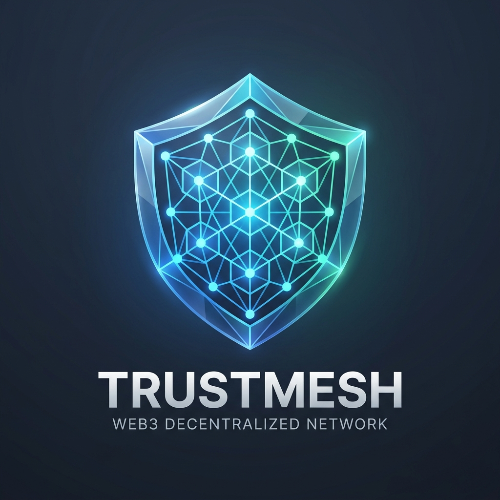
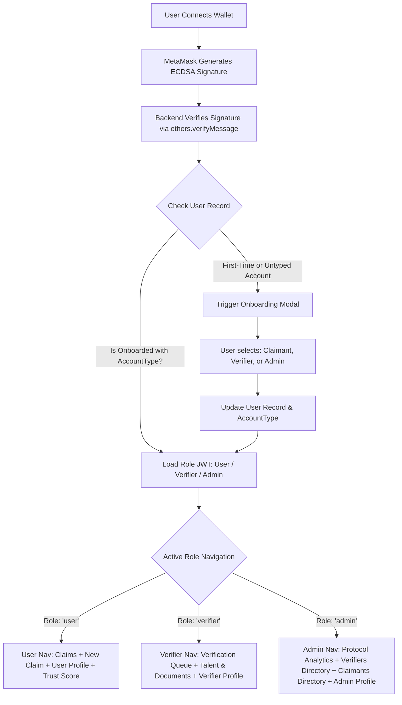
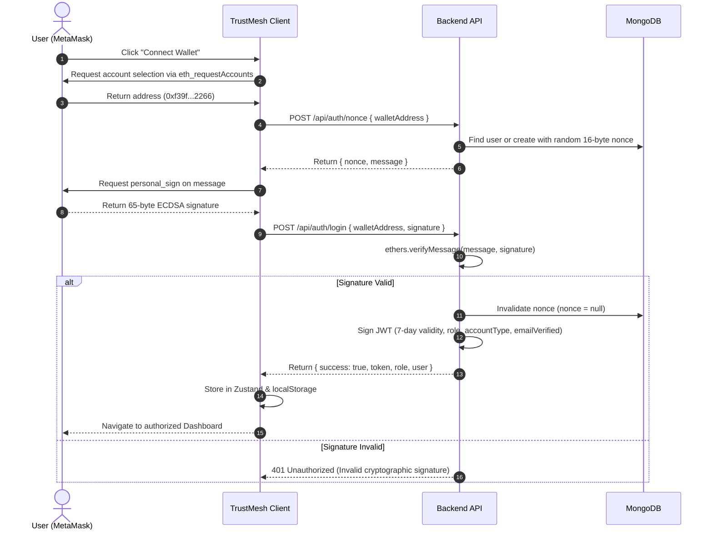
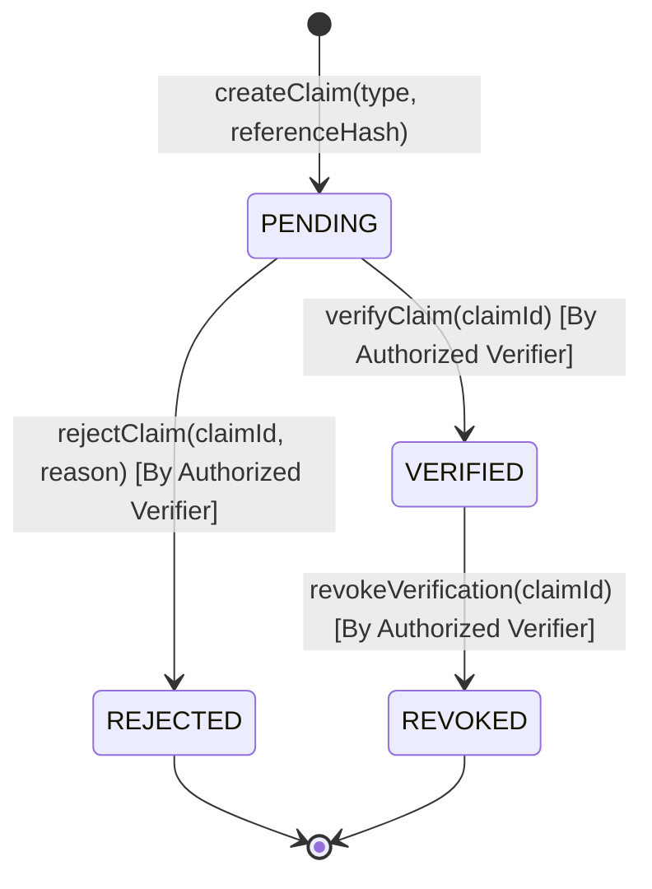

# TrustMesh — Product Architecture & Technical Documentation

<p align="center">
  
</p>

<p align="center">
  <strong>Decentralized Verifiable Credential & Reputation Network</strong><br />
  <em>Cryptographically anchored claims, peer-to-peer verifier attestation, on-chain smart contract registries, interactive governance analytics, and dynamic credibility scoring.</em>
</p>

<p align="center">
  
  
  
  
  
</p>

---

## 1. Product Overview

### What the Product Is
**TrustMesh** is a Web3-native decentralized verification and reputation protocol. It bridges real-world achievements, professional credentials, academic qualifications, and identity attestations with on-chain Ethereum smart contracts, cryptographic evidence fingerprints, and W3C-compliant verifiable reports.

### The Problem It Solves
Traditional professional credentialing (e.g., resumes, digital certificates, paper documents) suffers from:
1. **Rampant credential fraud**: Resumes and digital certificates are trivially forged or edited with software.
2. **Centralized gatekeeping**: Institutions charge exorbitant fees, take weeks to confirm credentials, or go out of business, leaving historical records unverifiable.
3. **Absence of cryptographic evidence binding**: Uploaded credentials rarely prove the exact immutability of the source document at the moment of issuance.
4. **Binary trust models**: Traditional platforms offer no graduated, transparent, mathematically auditable "Trust Score" computed from peer verifications, evidentiary hashes, and on-chain attestations.

### Who Uses It
* **Claimants (Professionals, Students, Developers)**: Individuals who publish claims regarding degrees, licenses, skills, project contributions, or employment, bind them to client-side SHA-256 evidence fingerprints, and secure on-chain verification.
* **Authorized Institutional Verifiers (Universities, Companies, Auditors)**: Accredited entities who review uploaded evidentiary artifacts, inspect cryptographic integrity hashes, validate email domains via OTP, and execute on-chain attestation transactions (`verifyClaim` or `rejectClaim`).
* **Protocol Administrators**: Governance operators who oversee the network, monitor protocol velocity via real-time analytics graphs, manage accredited verifiers, and enforce platform standards.
* **Third-Party Verifiers & Employers**: Public evaluators who inspect an applicant’s public Trust Score, audit verifiable PDF credentials, and verify that evidentiary files have not been modified.

### Main Value Proposition
* **Zero-Knowledge Evidence Integrity**: Evidence documents are hashed directly in the browser via SHA-256 before transit. The hash is permanently sealed inside the Ethereum smart contract. Any 1-bit alteration to the document invalidates the proof.
* **Dual-Layer Attestation Architecture**: Combines off-chain verification (cryptographic email OTP validation and metadata validation) with immutable on-chain smart contract state transitions.
* **Algorithmic Credibility Engine**: Calculates a dynamic Trust Score (0–100) per wallet address based on verification ratio, evidence completeness, identity validation, and weighted category stakes.
* **Passwordless Cryptographic Authentication**: 100% wallet-based sign-in using ECDSA cryptographic signatures (`ethers.verifyMessage`) with one-time server nonces to eliminate phishing and credential database breaches.
* **Role-Specific Profile Architecture**: Distinct tailored interfaces for Claimants, Institutional Verifiers, and Protocol Administrators rather than a single monolithic profile.
* **Interactive Protocol Analytics**: Built-in visual dashboard for protocol administrators displaying interactive multi-stream growth charts, attestation category distributions, verifier leaderboards, and reputation tier histograms.

---

## 2. Key Features

### Feature Matrix

| Feature | Category | Allowed Roles | Internal Mechanics | Interacts With |
| :--- | :--- | :--- | :--- | :--- |
| **Wallet Authentication (EIP-4361)** | Authentication | Public / All | Signs random cryptographic nonce via `personal_sign`. Backend verifies address with `ethers.verifyMessage` and issues 7-day JWT. | MetaMask, Express API, MongoDB |
| **Role Selection & Switcher Modal** | Onboarding | Authenticated | Explicit onboarding prompt selecting User, Verifier, or Admin with instant top navigation switching (`Change Role / ⚙️`). | Client Header, Express API, Zustand |
| **Role-Specific Profile Router** | Identity | All Roles | Routes users strictly to their role view: `UserProfilePage`, `VerifierProfilePage`, or `AdminProfilePage`. | Client Router, Express API, MongoDB |
| **Email OTP Verification** | Security | All Roles | Generates 6-digit cryptographic OTP, stores salted SHA-256 hash with 5-minute expiry, sends HTML email via Gmail SMTP. | Express API, Nodemailer, MongoDB |
| **Evidence SHA-256 Hashing** | Security | Claimant | Computes cryptographic digest using browser Web Crypto API / Multer SHA-256 stream. Guarantees tamper-evident audit trail. | Client Browser, Express API, Local Storage |
| **On-Chain Claim Creation** | Blockchain Operations | Claimant | Executes `createClaim(claimType, referenceHash)` on smart contract. Creates pending on-chain record with sequential `claimId`. | MetaMask, Smart Contract, Hardhat Node |
| **Cryptographic Claim Attestation** | Verification | Verifier, Admin | Verifier reviews claim, signs on-chain transaction calling `verifyClaim(claimId)` or `rejectClaim(claimId, reason)`. | MetaMask, Smart Contract, Express API |
| **Talent & Documents Directory** | Verification | Verifier, Admin | Full directory of registered talent profiles, evidence documents, claims history, and user suspension capabilities. | Verifier Portal, Express API, MongoDB |
| **Protocol Analytics Dashboard** | Governance & BI | Admin | Real-time SVG activity velocity charts, category breakdown, verifier throughput leaderboard, and trust distribution histogram. | Admin Portal, Express API, MongoDB |
| **Direct Verifier Authorization** | Admin Management | Admin | Admin invokes `registerVerifier(address, name, stake)` or `revokeVerifier(address)` on smart contract and updates backend permissions. | MetaMask, Smart Contract, Express API, MongoDB |
| **Dynamic Trust Score Engine** | Reputation | Public / All | Calculates weighted score (0–100) aggregating verified claims, evidence completeness, email validation, and verifier diversity dampening. | Express API, MongoDB, SVG Gauge |
| **Official Verifiable Proof Report** | Credentialing | Public / All | Institutional W3C-compliant certificate with A4 print/PDF pagination, verifier email/org, QR code verification, and cryptographic consensus seal. | Proof Report (`/proof-report/:wallet`), Express API |

---

## 3. User Roles & Architecture

### Role Matrix

| Role | Interface Scope | Main Capabilities | Prohibited Operations | Blockchain Permissions |
| :--- | :--- | :--- | :--- | :--- |
| **Claimant (`user` / `owner`)** | User Profile (`/profile`), My Claims (`/claims`, `/claims/new`) | Create claims, upload evidence, trigger email OTP, track own credentials, view public Trust Scores, export Proof Reports. | Cannot verify claims; cannot authorize or revoke verifiers. | Can call `createClaim()`. |
| **Institutional Verifier (`verifier`)** | Verifier Profile (`/profile`), Verifier Portal (`/verifier`) | Inspect claims queue, audit evidence files in "Talent & Documents", attest or reject claims with cryptographic reasons, flag suspicious users. | Cannot register new verifiers; cannot modify governance parameters. | Can call `verifyClaim()`, `rejectClaim()`, `revokeVerification()`. |
| **Protocol Administrator (`admin`)** | Admin Profile (`/profile`), Governance Analytics (`/admin`) | Monitor protocol velocity via interactive charts, whitelist/revoke verifiers on-chain, manage platform claimants (suspend/reinstate). | Cannot forge claimant signatures or alter historical transaction receipts. | Can call `registerVerifier()`, `revokeVerifier()`, `verifyClaim()`, `rejectClaim()`. |

### Role-Based Access Architecture



---

## 4. Authentication & Sign-In

TrustMesh implements passwordless, cryptographic authentication compliant with Web3 identity standards (EIP-4361).



---

## 5. Wallet & MetaMask Setup

### Network Parameters (Local Hardhat Node)

| Configuration Parameter | Exact Value |
| :--- | :--- |
| **Network Name** | `Hardhat Localhost` (or `TrustMesh Local`) |
| **Default RPC URL** | `http://127.0.0.1:8545` *(Must include http://)* |
| **Chain ID** | `31337` |
| **Currency Symbol** | `ETH` |
| **Block Explorer URL** | *(Leave blank for local environment)* |
| **Deployed Contract Address** | `0xe7f1725E7734CE288F8367e1Bb143E90bb3F0512` |

### Funded Development Accounts
The local blockchain container auto-generates 20 pre-funded test accounts with **10,000 ETH** each:

* **Account #0 (Deployer / Default Admin)**:
  * Public Address: `0xf39Fd6e51aad88F6F4ce6aB8827279cffFb92266`
  * Private Key: `0xac0974bec39a17e36ba4a6b4d238ff944bacb478cbed5efcae784d7bf4f2ff80`
* **Account #1 (Default Verifier / Test Claimant)**:
  * Public Address: `0x70997970C51812dc3A010C7d01b50e0d17dc79C8`
  * Private Key: `0x59c6995e998f97a5a0044966f0945389dc9e86dae88c7a8412f4603b6b78690d`

---

## 6. Smart Contract Architecture (`TrustMesh.sol`)

### Contract Summary
* **Contract Name**: `TrustMesh`
* **Solidity Version**: `^0.8.20`
* **License**: MIT
* **Deployed Address**: `0xe7f1725E7734CE288F8367e1Bb143E90bb3F0512`

### State Transitions (`ClaimStatus`)



### On-Chain Functions Reference

| Function | Type | Caller | Purpose |
| :--- | :--- | :--- | :--- |
| `createClaim(string,string)` | Write | Any User | Creates a new claim anchored with an evidentiary SHA-256 hash. |
| `verifyClaim(uint256)` | Write | Authorized Verifier | Seals claim verification permanently onto the blockchain. |
| `rejectClaim(uint256,string)` | Write | Authorized Verifier | Records claim rejection with reason string. |
| `registerVerifier(address,string,uint256)` | Write | Admin (Deployer) | Grants institutional verification permissions to an address. |
| `revokeVerifier(address)` | Write | Admin (Deployer) | Revokes institutional verification permissions from an address. |
| `getClaim(uint256)` | Read | Public | Retrieves full on-chain claim struct including hash, verifier, and status. |

---

## 7. Dashboard & Module Breakdown

### 1. Landing Page (`/`)
* Hero banner featuring the 3D glowing product logo, protocol statistics, core value propositions, and direct MetaMask wallet connection.

### 2. User Credentials & Claims (`/claims`, `/claims/new`)
* Dedicated hub for claimants to create claims, attach evidentiary files, auto-compute client-side SHA-256 fingerprints, and broadcast transactions to `TrustMesh.sol`.

### 3. Role-Specific Profile Pages (`/profile`)
* **User Profile (`UserProfilePage.jsx`)**: Personal info, skills, education, work experience, attached identity documents, trust score breakdown, and direct export to the official Proof Report.
* **Verifier Profile (`VerifierProfilePage.jsx`)**: Institutional organization name, professional designation, accreditation documents, active verification status badge, and smart contract clearance (`0xe7f1...0512`).
* **Admin Profile (`AdminProfilePage.jsx`)**: Protocol administrator governance tier, master deployer address, and root authority metadata.

### 4. Institutional Verifier Portal (`/verifier`)
* **Pending Claims Queue**: Review incoming claim attestations with automated pre-flight integrity checks.
* **Talent & Documents Tab**: Inspect registered user profiles, attached evidence files, claim statistics, and flag suspicious claimants with instant suspension.

### 5. Admin Governance & Intelligence Dashboard (`/admin`)
* **Protocol Analytics Tab**:
  * 4 KPI cards: Total Claimants, Authorized Verifiers, Verified Credentials, Protocol Trust Index.
  * Interactive SVG Growth Chart with multi-stream toggling (`All Streams`, `Claims`, `Verifications`, `Users`) and hover tooltips.
  * Attestation Category Distribution bars (Education, Experience, Skills, Other).
  * Institutional Verifier Performance Leaderboard.
  * Ecosystem Trust Score Distribution Histogram across all 5 reputation tiers.
* **Authorized Verifiers Tab**: Directory of active institutional verifiers with on-chain revocation and direct registration form.
* **Platform Claimants Tab**: Searchable directory of claimants with trust score badges and Suspend/Reinstate actions.

### 6. Dynamic Trust Score Dashboard (`/trust-score/:wallet`)
* Interactive radial score gauge (0–100), source weighting breakdown (+10 Org, +8 Mentor/Work, +3 Peer/Skill), reputation badges (*Rising Member*, *Trusted Contributor*, *Verified Expert*, *Master of Trust*), and contributing verified credentials list.
* Robust dual-lookup supporting both Ethereum wallet addresses (`0x...`) and MongoDB `ObjectId`s.

### 7. Official Verifiable Credential Dossier (`/proof-report/:wallet`)
* Institutional W3C-compliant credential report with dedicated `@media print` rules for single-sheet A4 PDF printing.
* Detailed verifier metadata: Authorized Verifier Name, Organization, Official Email, Ethereum Address, Attestation Protocol, Ethereum Tx Hash, and SHA-256 Merkle Digest.
* Subject biographic information: Skills tags, Academic credentials, Professional experience, Level 2 Assurance badge.
* Vector verification QR code linking to public verification ledger, Decentralized Consensus Seal, and Registrar Signatory box.

---

## 8. Complete REST API Reference

| Method | Endpoint | Auth Required | Minimum Role | Purpose |
| :--- | :--- | :--- | :--- | :--- |
| `POST` | `/api/auth/nonce` | Public | None | Generates random 16-byte nonce and sign-in message for wallet |
| `POST` | `/api/auth/login` | Public | None | Verifies ECDSA signature, returns JWT session and role |
| `POST` | `/api/auth/switch-role` | Bearer Token | Authenticated | Switches active role between `user`, `verifier`, and `admin` |
| `POST` | `/api/auth/send-otp` | Bearer Token | Authenticated | Generates 6-digit OTP and sends email via SMTP |
| `POST` | `/api/auth/verify-otp` | Bearer Token | Authenticated | Validates submitted OTP and sets `emailVerified=true` |
| `GET` | `/api/profile/:wallet`| Public | None | Fetches profile, enriched claims with verifier email/org, and live trust score |
| `PUT` | `/api/profile` | Bearer Token | Authenticated | Updates profile headline, bio, skills, education, experience, documents |
| `GET` | `/api/claims` | Public | None | Lists claims with optional filters (`status`, `type`, `wallet`) |
| `POST` | `/api/claims` | Bearer Token | `user` | Creates new claim record in database |
| `GET` | `/api/claims/:id` | Public | None | Retrieves single claim with populated verification log |
| `POST` | `/api/claims/:id/evidence` | Bearer Token | `user` | Uploads evidence file, computes SHA-256 digest |
| `GET` | `/api/trust-score/:profileIdOrWallet` | Public | None | Computes live trust score supporting both `0x...` wallets and ObjectIds |
| `GET` | `/api/verifiers` | Public | None | Lists all authorized verifiers |
| `POST` | `/api/verifiers` | Bearer Token | `admin` | Authorizes new verifier address on-chain and database |
| `DELETE`| `/api/verifiers/:wallet`| Bearer Token | `admin` | Revokes verifier authorization |
| `GET` | `/api/verifiers/admin-overview` | Bearer Token | `admin` | Fetches complete analytics dashboard data, activity trends, and directories |
| `GET` | `/api/verifiers/users-directory` | Bearer Token | `verifier` | Fetches all claimants with attached documents for verifier inspection |
| `POST` | `/api/verifiers/users/:wallet/suspend` | Bearer Token | `verifier` | Flags and suspends a suspicious claimant account |
| `POST` | `/api/verifiers/users/:wallet/reinstate` | Bearer Token | `verifier` | Reinstates a suspended claimant account |
| `GET` | `/api/health` | Public | None | Service liveness and readiness check |

---

## 9. Configuration & Environment Variables

### Master Environment Matrix

| Variable | Scope | Purpose | Example Default |
| :--- | :--- | :--- | :--- |
| `PORT` | Server | HTTP port for Node.js REST API | `5000` |
| `MONGO_URI` | Server | MongoDB connection string | `mongodb://mongo:27017/trustmesh` |
| `RPC_URL` | Server | JSON-RPC provider endpoint for Hardhat Node | `http://blockchain:8545` |
| `CONTRACT_ADDRESS` | Server / Client | Deployed `TrustMesh.sol` contract address | `0xe7f1725E7734CE288F8367e1Bb143E90bb3F0512` |
| `JWT_SECRET` | Server | Secret key for signing session tokens | `trustmesh_jwt_secret_dev_key` |
| `ADMIN_WALLET` | Server | Designated root administrator wallet address | `0xf39fd6e51aad88f6f4ce6ab8827279cfffb92266` |
| `EMAIL_HOST` | Server | SMTP host for email dispatch | `smtp.gmail.com` |
| `EMAIL_PORT` | Server | SMTP port (587 for TLS, 465 for SSL) | `587` |
| `EMAIL_USER` | Server | Authenticated SMTP email account username | `trushmesh.official@gmail.com` |
| `EMAIL_PASS` | Server | Google 16-character App Password | `twsfvzfuxqjilyni` |
| `EMAIL_FROM` | Server | Outgoing sender display header | `"TrustMesh" <trushmesh.official@gmail.com>` |
| `VITE_API_BASE_URL` | Client | API root URL consumed by browser Axios instance | `http://localhost:5000/api` |
| `VITE_CHAIN_ID` | Client | Expected network Chain ID for wallet prompts | `31337` |

---

## 10. Local Deployment with Docker Compose

### 1-Command Launch
TrustMesh is fully containerized with 4 coordinated services:

```powershell
# 1. Navigate to project root
cd "C:\1_All_stuff\College projects\TRUSTMESH"

# 2. Build and launch all containers
docker compose up -d --build
```

### Container Status Verification
```powershell
docker compose ps
```

Expected output:
```text
NAME                   IMAGE                  STATUS          PORTS
trustmesh-client       trustmesh-client       Up (healthy)    0.0.0.0:5173->80/tcp
trustmesh-server       trustmesh-server       Up (healthy)    0.0.0.0:5000->5000/tcp
trustmesh-blockchain   trustmesh-blockchain   Up (healthy)    0.0.0.0:8545->8545/tcp
trustmesh-mongo        mongo:7.0              Up (healthy)    0.0.0.0:27017->27017/tcp
```

### Service Access Endpoints
* **Web Application UI**: [http://localhost:5173](http://localhost:5173)
* **Backend REST API**: [http://localhost:5000/api/health](http://localhost:5000/api/health)
* **Hardhat JSON-RPC Node**: `http://localhost:8545`
* **MongoDB Instance**: `localhost:27017`

---

## 11. Quick Testing Flow

1. **Connect MetaMask**: Open `http://localhost:5173` and click **Connect Wallet** using Hardhat Account #0 (`0xf39f...2266`).
2. **Select Account Type**: When prompted, choose **Claimant**, **Institutional Verifier**, or **Protocol Administrator**.
3. **Submit Claims**: Navigate to **+ New Claim** (`/claims/new`), upload evidence, and sign the on-chain `createClaim` transaction in MetaMask.
4. **Inspect & Verify**: Use the role switcher to switch to **🔍 Verifier**, navigate to **Verifier Portal** (`/verifier`), review evidence in the queue or *Talent & Documents*, and attest the claim.
5. **View Analytics**: Switch to **🛡️ Admin**, open **Admin Governance** (`/admin`), and view the interactive activity graphs and distribution charts.
6. **Generate Proof Report**: Open **Trust Score** (`/trust-score/:wallet`) and click **Generate Proof Report →** (`/proof-report/:wallet`) to inspect or print the official certificate.

---

## 12. License
TrustMesh is open-source software licensed under the **[MIT License](LICENSE)**.
