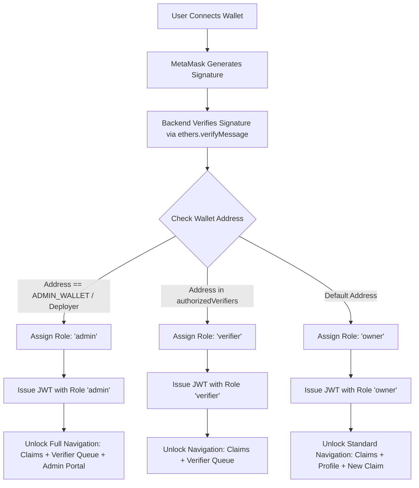
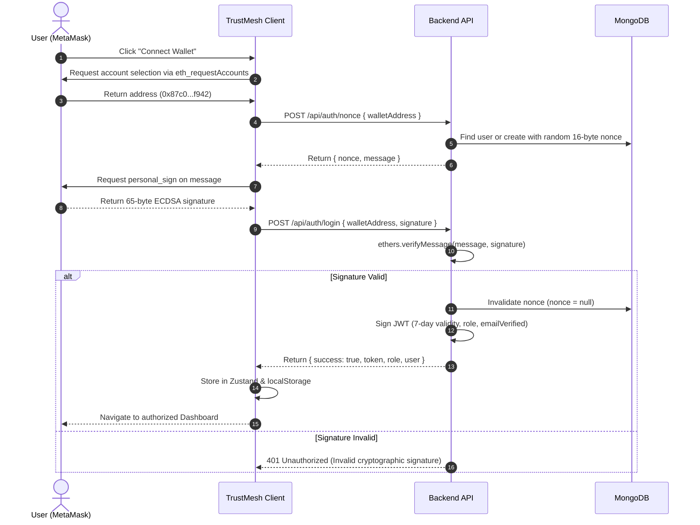
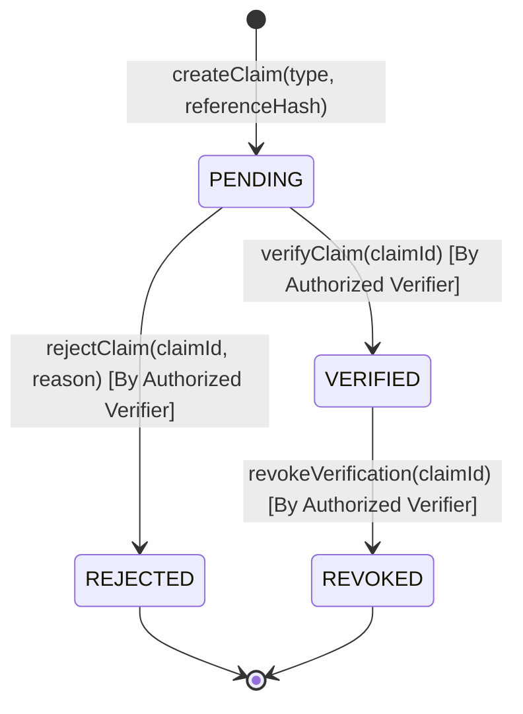
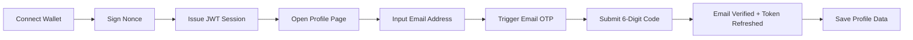
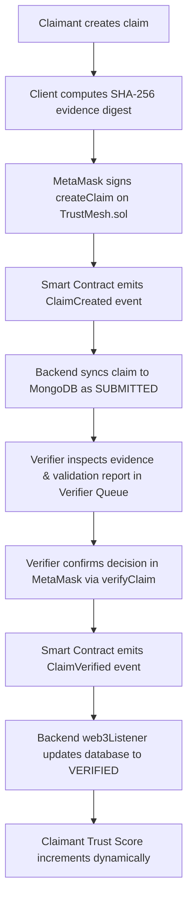
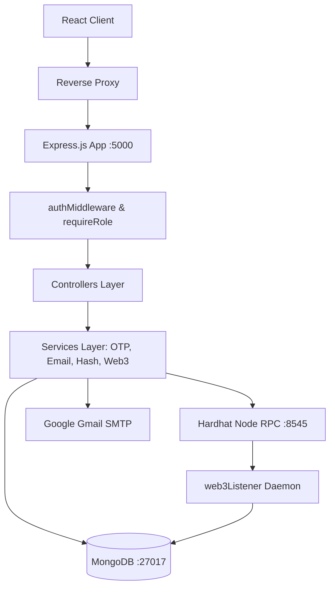
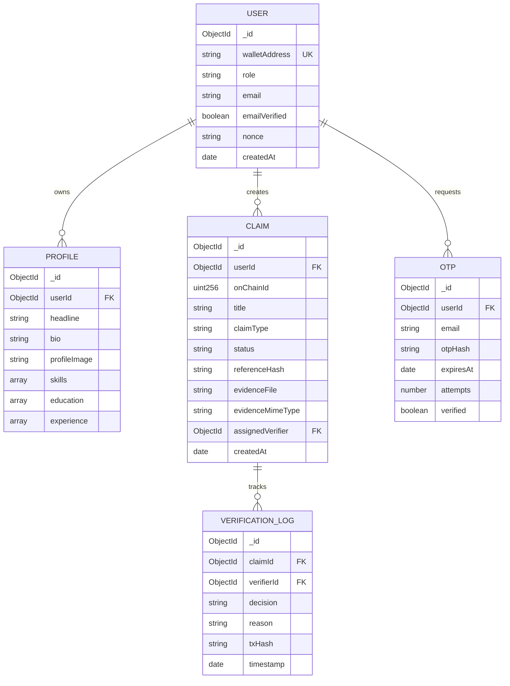

# TrustMesh — Product Architecture & Technical Documentation

> **Decentralized Verifiable Credential & Reputation Network**  
> *Cryptographically anchored claims, peer-to-peer verifier attestation, on-chain smart contract registries, and dynamic credibility scoring.*

---

## 1. Product Overview

### What the Product Is
**TrustMesh** is a Web3-native decentralized verification and reputation protocol. It bridges real-world achievements, professional credentials, academic qualifications, and identity attestations with on-chain Ethereum smart contracts and cryptographic proofs.

### The Problem It Solves
Traditional professional credentialing (e.g., resumes, digital certificates, paper documents) suffers from:
1. **Rampant credential fraud**: Resumes and digital certificates are trivially forged or edited with software.
2. **Centralized gatekeeping**: Institutions charge exorbitant fees, take weeks to confirm credentials, or go out of business, leaving historical records unverifiable.
3. **Absence of cryptographic evidence binding**: Uploaded credentials rarely prove the exact immutability of the source document at the moment of issuance.
4. **Binary trust models**: Traditional platforms offer no graduated, transparent, mathematically auditable "Trust Score" computed from peer verifications, evidentiary hashes, and on-chain attestations.

### Who Uses It
* **Claimants (Professionals, Students, Developers)**: Individuals who publish claims regarding degrees, licenses, skills, project contributions, or employment, bind them to client-side SHA-256 evidence fingerprints, and secure on-chain verification.
* **Authorized Verifiers (Institutions, Senior Auditors, Peer Evaluators)**: Authorized entities who review uploaded evidentiary artifacts, inspect cryptographic integrity hashes, validate email domains via OTP, and execute on-chain attestation transactions (`verifyClaim` or `rejectClaim`).
* **Protocol Administrators**: Governance operators who authorize and manage the on-chain registry of accredited verifier addresses and enforce network standards.
* **Third-Party Verifiers & Employers**: Public evaluators who inspect an applicant’s public Trust Score, examine raw transaction receipts on the blockchain, and verify that evidentiary files have not been modified.

### Main Value Proposition
* **Zero-Knowledge Evidence Integrity**: Evidence documents are hashed directly in the browser via SHA-256 before transit. The hash is permanently sealed inside the Ethereum smart contract. Any 1-bit alteration to the document invalidates the proof.
* **Dual-Layer Attestation Architecture**: Combines off-chain verification (cryptographic email OTP validation and metadata validation) with immutable on-chain smart contract state transitions.
* **Algorithmic Credibility Engine**: Calculates a dynamic Trust Score (0–100) per wallet address based on verification ratio, evidence completeness, identity validation, and weighted category stakes.
* **Passwordless Cryptographic Authentication**: 100% wallet-based sign-in using ECDSA cryptographic signatures (`ethers.verifyMessage`) with one-time server nonces to eliminate phishing and credential database breaches.

### Technical Overview
* **Blockchain Layer**: Solidity smart contract (`TrustMesh.sol` v0.8.20) running on EVM networks (Local Hardhat Node, Ethereum Mainnet/Sepolia, or EVM-compatible Layer 2s).
* **Backend API Layer**: Node.js & Express RESTful services with JSON Web Token session management, event-driven Web3 listeners (`ethers.js` v6), Nodemailer SMTP with Google App Password integration, and SHA-256 salted OTP hashing.
* **Data Storage**: MongoDB replica model with Mongoose schemas for off-chain profiles, claims metadata, and audit log indexing.
* **Client Frontend**: React 18, Vite, Tailwind CSS, Zustand state persistence, and native MetaMask/EIP-1193 wallet integration.
* **DevOps Orchestration**: Multi-container Docker Compose pipeline (`trustmesh-client`, `trustmesh-server`, `trustmesh-blockchain`, `trustmesh-mongo`).

---

## 2. Key Features

### Feature Matrix

| Feature | Category | Allowed Roles | Internal Mechanics | Interacts With |
| :--- | :--- | :--- | :--- | :--- |
| **Wallet Authentication (EIP-4361)** | Authentication | Public / All | Signs random cryptographic nonce via `personal_sign`. Backend verifies address with `ethers.verifyMessage` and issues 7-day JWT. | MetaMask, Express API, MongoDB |
| **Email OTP Verification** | Security | Owner, Verifier, Admin | Generates 6-digit cryptographic OTP, stores salted SHA-256 hash with 5-minute expiry, sends HTML email via Gmail SMTP. Issues refreshed JWT upon match. | Express API, Nodemailer, MongoDB |
| **Self-Sovereign Trust Profile** | User Management | Owner, Verifier, Admin | Stores professional headline, biography, avatar, education, work experience, and verified skill tags linked to wallet address. | Express API, MongoDB |
| **Evidence SHA-256 Hashing** | Security | Owner | Computes cryptographic digest using browser Web Crypto API / Multer SHA-256 stream. Guarantees tamper-evident audit trail. | Client Browser, Express API, Local Storage |
| **On-Chain Claim Creation** | Blockchain Operations | Owner | Executes `createClaim(claimType, referenceHash)` on smart contract. Creates pending on-chain record with sequential `claimId`. | MetaMask, Smart Contract, Hardhat Node |
| **Automated Evidence Pre-Check** | Verification | Verifier, Admin | Evaluates evidence presence, mime type, hash match, and email verification status before permitting formal review. | Express API, MongoDB |
| **Cryptographic Claim Attestation** | Verification | Verifier, Admin | Verifier reviews claim, signs on-chain transaction calling `verifyClaim(claimId)` or `rejectClaim(claimId, reason)`. | MetaMask, Smart Contract, Express API |
| **Verifier Governance Registry** | Admin Management | Admin | Admin invokes `registerVerifier(address, name, stake)` or `revokeVerifier(address)` on smart contract and updates backend permissions. | MetaMask, Smart Contract, Express API, MongoDB |
| **Dynamic Trust Score Engine** | Analytics | Public / All | Calculates weighted score (0–100) aggregating verified claims, evidence completeness, email validation, and rejected claim penalties. | Express API, MongoDB |
| **Real-Time Blockchain Sync** | Data Management | System Daemon | Background Web3 listener monitors smart contract events (`ClaimCreated`, `ClaimVerified`, etc.) and synchronizes off-chain database state. | Smart Contract, Express Service, MongoDB |
| **Active Testing Role Switcher** | Configuration | Authenticated | Allows instant switching between Owner, Verifier, and Admin testing perspectives in development via `/api/auth/switch-role`. | Client Header, Express API, Zustand |

---

## 3. User Roles & Permissions

### Role Matrix

| Role | Scope | Main Capabilities | Prohibited Operations | Blockchain Permissions | Backend API Permissions |
| :--- | :--- | :--- | :--- | :--- | :--- |
| **Claimant (`owner`)** | User Dashboard (`/claims`, `/profile`) | Create claims, upload evidence, trigger email OTP, track own credentials, view public Trust Scores. | Cannot verify claims; cannot authorize or revoke verifiers. | Can call `createClaim()`. | Access to `/api/claims` (own), `/api/profile`, `/api/auth/*`. |
| **Verifier (`verifier`)** | Verifier Portal (`/verifier`) | Inspect pending verification queue, execute evidence audits, attest or reject claims with cryptographic reasons. | Cannot register new verifiers; cannot modify system parameters. | Can call `verifyClaim()`, `rejectClaim()`, `revokeVerification()`. | Access to `/api/verification/*`, `/api/claims`, `/api/profile`. |
| **Administrator (`admin`)** | Governance Portal (`/admin`, `/verifier`) | Authorize/revoke verifiers on-chain, inspect network audit trails, act as super-verifier, manage system nodes. | Cannot forge claimant signatures or alter historical transaction receipts. | Can call `registerVerifier()`, `revokeVerifier()`, `verifyClaim()`, `rejectClaim()`. | Full access to `/api/verifiers/*`, `/api/verification/*`, `/api/claims/*`, `/api/profile/*`. |

### Role-Based Access Flow



---

## 4. Authentication & Sign-In

TrustMesh implements passwordless, cryptographic authentication compliant with Web3 identity standards.



### Signature Authentication vs. Blockchain Transactions
* **Authentication Signature (`personal_sign`)**:
  * **Cost**: Free (0 Gas).
  * **Action**: Cryptographic proof of ownership over the private key corresponding to the public address. Does not alter blockchain state.
  * **Replay Protection**: The backend issues a cryptographically random, one-time 16-byte hex nonce. Once validated, the nonce is wiped immediately (`user.nonce = null`). Old signatures cannot be replayed.
* **Blockchain Transaction (`eth_sendTransaction`)**:
  * **Cost**: Requires ETH gas fees.
  * **Action**: Modifies state on the Ethereum virtual machine (e.g., executing `createClaim` or `verifyClaim`). Requires block miner/validator inclusion.

---

## 5. Wallet & MetaMask Setup

### Network Parameters (Local Hardhat Node)

| Configuration Parameter | Exact Value |
| :--- | :--- |
| **Network Name** | `Hardhat Localhost` (or `TrustMesh Local`) |
| **Default RPC URL** | `http://127.0.0.1:8545` *(Must include http://)* |
| **Chain ID** | `31337` |
| **Currency Symbol** | `ETH` |
| **Block Explorer URL** | *(Leave blank for local environment)* |
| **Deployed Contract Address** | `0xe7f1725E7734CE288F8367e1Bb143E90bb3F0512` |

### Funded Development Accounts
The local blockchain container auto-generates 20 pre-funded test accounts with **10,000 ETH** each:

* **Account #0 (Deployer / Default Admin)**:
  * Public Address: `0xf39Fd6e51aad88F6F4ce6aB8827279cffFb92266`
  * Private Key: `0xac0974bec39a17e36ba4a6b4d238ff944bacb478cbed5efcae784d7bf4f2ff80`
* **Account #1 (Default Verifier / Test Claimant)**:
  * Public Address: `0x70997970C51812dc3A010C7d01b50e0d17dc79C8`
  * Private Key: `0x59c6995e998f97a5a0044966f0945389dc9e86dae88c7a8412f4603b6b78690d`

### Network Switching Flow
1. When the user connects, `WalletConnectButton.jsx` reads `provider.getNetwork()`.
2. If the `chainId` is not `31337`, the client automatically calls `wallet_switchEthereumChain` with hex `0x7a69`.
3. If the network is not yet added to MetaMask (error code `4902`), the user is prompted to add the network using the parameters above.

---

## 6. Ethereum / Blockchain Integration

### Web3 Architecture
* **Library**: `ethers` v6 (`BrowserProvider` for frontend interaction; `JsonRpcProvider` for backend daemon).
* **Signer**: Web3 provider signer obtained via `await provider.getSigner()` for transaction execution.
* **ABI Artifacts**: Shared auto-exported ABI located at `client/src/contracts/TrustMesh.json` and `server/src/contracts/TrustMesh.json`.

### Blockchain Operations Table

| Operation | Type | Wallet Required | Gas Required | Contract Function | Caller |
| :--- | :--- | :--- | :--- | :--- | :--- |
| **Register Profile** | Write | Yes | Yes | `registerProfile()` | Any Wallet |
| **Create Claim** | Write | Yes | Yes | `createClaim(string,string)` | Claimant |
| **Assign Verifier** | Write | Yes | Yes | `assignVerifier(uint256,address)` | Claimant / Owner |
| **Verify Claim** | Write | Yes | Yes | `verifyClaim(uint256)` | Authorized Verifier |
| **Reject Claim** | Write | Yes | Yes | `rejectClaim(uint256,string)` | Authorized Verifier |
| **Revoke Verification**| Write | Yes | Yes | `revokeVerification(uint256)` | Authorized Verifier |
| **Register Verifier** | Write | Yes | Yes | `registerVerifier(address,string,uint256)` | Admin (Owner) |
| **Revoke Verifier** | Write | Yes | Yes | `revokeVerifier(address)` | Admin (Owner) |
| **Read Claim State** | Read | No | No | `getClaim(uint256)` | Public |
| **Check Verifier Status**| Read | No | No | `authorizedVerifiers(address)` | Public |
| **Get User Claims** | Read | No | No | `getUserClaims(address)` | Public |

---

## 7. Smart Contract Architecture (`TrustMesh.sol`)

### Contract Overview
* **Contract Name**: `TrustMesh`
* **Solidity Version**: `^0.8.20`
* **License**: MIT
* **Storage Mappings**:
  * `mapping(uint256 => Claim) public claims`: Stores claim struct by numeric ID.
  * `mapping(address => uint256[]) public userClaims`: Maps user wallets to claim ID arrays.
  * `mapping(address => bool) public authorizedVerifiers`: Registry of accredited verifier addresses.
  * `mapping(address => bool) public registeredProfiles`: Registry of on-chain initialized profile owners.
* **Access Modifiers**:
  * `onlyOwner`: Restricts governance functions to the contract deployer.
  * `onlyAuthorizedVerifier`: Restricts attestation functions to authorized verifiers.
  * `onlyClaimant(claimId)`: Prevents unauthorized modification of claims.
  * `validClaim(claimId)`: Verifies claim existence within `1 <= claimId <= claimCounter`.

### State Transitions (`ClaimStatus`)



---

## 8. Complete Product Lifecycle Workflows

### 1. New User Registration & Profile Setup


### 2. End-to-End Claim Creation & Attestation


---

## 9. Dashboard & Product Modules

### 1. Landing Page (`/`)
* **Purpose**: High-impact portal introducing the protocol, key value drivers, architecture breakdown, and call-to-actions.
* **Accessible By**: Public.
* **Actions**: Connect Wallet, explore features, view architectural advantages.

### 2. User Credentials & Claims (`/claims`)
* **Purpose**: Management hub for all credentials belonging to the connected wallet.
* **Accessible By**: Claimant (`owner`), Verifier, Admin.
* **Actions**: Filter claims (All, Verified, Pending, Draft, Rejected), inspect evidence SHA-256 fingerprints, launch claim creation wizard.

### 3. Claim Creation Wizard (`/claims/new`)
* **Purpose**: Multi-step credential publication pipeline.
* **Accessible By**: Authenticated Claimants.
* **Actions**: Select category (Education, Experience, Certification, Skill, Achievement), input organization and issuance date, upload evidence file (PDF/PNG), auto-compute SHA-256 hash, broadcast on-chain transaction.

### 4. Claim Deep-Dive & Audit (`/claims/:id`)
* **Purpose**: Cryptographic audit inspection view.
* **Accessible By**: Public / All.
* **Actions**: Verify document hash against on-chain hash, inspect verifier address, review rejection reasons (if applicable), view timeline progression.

### 5. Verifier Queue (`/verifier`)
* **Purpose**: Operational dashboard for accredited auditors.
* **Accessible By**: `verifier`, `admin`.
* **Actions**: Inspect pending claims, view automated evidence pre-check reports (MIME type, file presence, email verification state), execute cryptographic approval or rejection with on-chain reason string.

### 6. Admin Governance Portal (`/admin`)
* **Purpose**: On-chain and off-chain verifier network management.
* **Accessible By**: `admin`.
* **Actions**: Whitelist new verifier addresses via `registerVerifier()`, revoke rogue verifier nodes via `revokeVerifier()`, view active verifiers list.

### 7. Trust Profile & Identity (`/profile`)
* **Purpose**: Decentralized identity management.
* **Accessible By**: Authenticated users.
* **Actions**: Update name, bio, skills, education, experience; execute secure Email OTP validation without disrupting other saved fields.

### 8. Trust Score Analytics (`/trust-score/:wallet`)
* **Purpose**: Transparent credibility scoring visualizer.
* **Accessible By**: Public / All.
* **Actions**: View 0–100 radial trust gauge, inspect category distribution, audit positive vs. negative factors.

---

## 10. Backend Architecture & REST API

### Backend Component Pipeline



### Complete REST API Reference

| Method | Endpoint | Auth Required | Minimum Role | Purpose |
| :--- | :--- | :--- | :--- | :--- |
| `POST` | `/api/auth/nonce` | Public | None | Generates random 16-byte nonce and sign-in message for wallet |
| `POST` | `/api/auth/login` | Public | None | Verifies ECDSA signature, returns JWT session and role |
| `POST` | `/api/auth/register` | Public | None | Initializes or updates basic user record |
| `POST` | `/api/auth/send-otp` | Bearer Token | `owner` | Generates 6-digit OTP and sends email via SMTP |
| `POST` | `/api/auth/verify-otp` | Bearer Token | `owner` | Validates submitted OTP, sets `emailVerified=true`, re-issues JWT |
| `POST` | `/api/auth/switch-role` | Bearer Token | `owner` | Switches active testing role for demonstration |
| `GET` | `/api/profile/:wallet`| Public | None | Fetches public profile, claims list, and live trust score |
| `POST` | `/api/profile` | Bearer Token | `owner` | Creates a new user profile record |
| `PUT` | `/api/profile` | Bearer Token | `owner` | Updates profile headline, bio, skills, education, and email |
| `GET` | `/api/claims` | Public | None | Lists claims with optional filters (`status`, `type`, `wallet`) |
| `POST` | `/api/claims` | Bearer Token | `owner` | Creates new claim record in database |
| `GET` | `/api/claims/:id` | Public | None | Retrieves single claim with populated verification log |
| `PUT` | `/api/claims/:id` | Bearer Token | `owner` | Updates existing draft claim |
| `DELETE`| `/api/claims/:id` | Bearer Token | `owner` | Deletes draft or rejected claim |
| `POST` | `/api/claims/:id/evidence` | Bearer Token | `owner` | Uploads evidence file, computes SHA-256 digest |
| `POST` | `/api/verification/evidence-check` | Bearer Token | `owner` | Runs automated pre-flight integrity check |
| `POST` | `/api/verification/request` | Bearer Token | `owner` | Transitions claim to requested status |
| `POST` | `/api/verification/sync` | Bearer Token | `verifier` | Synchronizes on-chain verification transaction to database |
| `GET` | `/api/verifiers` | Public | None | Lists all authorized verifiers |
| `POST` | `/api/verifiers` | Bearer Token | `admin` | Authorizes new verifier address |
| `DELETE`| `/api/verifiers/:wallet`| Bearer Token | `admin` | Revokes verifier authorization |
| `GET` | `/api/health` | Public | None | Service liveness and readiness check |

---

## 11. Database & Off-Chain Storage

### Mongoose Data Schemas



### On-Chain vs. Off-Chain Partitioning
* **On-Chain (Blockchain)**:
  * Claim ID, Claimant Wallet Address, Claim Type, Reference Hash (SHA-256 digest of evidence), Verification Status (Enum: `PENDING`, `VERIFIED`, `REJECTED`, `REVOKED`), Verifier Wallet Address, Block Timestamp, Authorized Verifiers Registry, Profile Initialization flags.
* **Off-Chain (MongoDB & Server Storage)**:
  * Full human-readable descriptions, company names, educational institutions, profile biographies, avatars, raw evidence binary files (`.pdf`, `.png`), email addresses, encrypted nonces, salted OTP hashes, audit logs, and transaction receipts.

---

## 12. Configuration & Environment Variables

All services support configuration through `.env` files.

### Master Environment Configuration Matrix

| Variable | Scope | Purpose | Required | Example Default |
| :--- | :--- | :--- | :---: | :--- |
| `PORT` | Server | HTTP port for Node.js REST API | Yes | `5000` |
| `MONGO_URI` | Server | MongoDB connection string | Yes | `mongodb://localhost:27017/trustmesh` |
| `RPC_URL` | Server | JSON-RPC provider endpoint for Hardhat / Ethereum | Yes | `http://127.0.0.1:8545` |
| `CONTRACT_ADDRESS` | Server / Client | Deployed `TrustMesh.sol` contract address | Yes | `0xe7f1725E7734CE288F8367e1Bb143E90bb3F0512` |
| `JWT_SECRET` | Server | Secret key for signing session tokens | Yes | `trustmesh_dev_jwt_secret_key_31337` |
| `ADMIN_WALLET` | Server | Designated root administrator wallet address | No | `0xf39fd6e51aad88f6f4ce6ab8827279cfffb92266` |
| `OTP_EXPIRY_MINUTES` | Server | Lifespan of 6-digit email verification codes | Yes | `5` |
| `MAX_UPLOAD_MB` | Server | Maximum evidence file upload size limit | Yes | `5` |
| `EMAIL_HOST` | Server | SMTP host for email dispatch | No | `smtp.gmail.com` |
| `EMAIL_PORT` | Server | SMTP port (587 for TLS, 465 for SSL) | No | `587` |
| `EMAIL_USER` | Server | Authenticated SMTP email account username | No | `your-email@gmail.com` |
| `EMAIL_PASS` | Server | Google 16-character App Password | No | `abcdefghijklmnop` |
| `EMAIL_FROM` | Server | Outgoing sender display header | No | `"TrustMesh" <your-email@gmail.com>` |
| `VITE_API_BASE_URL` | Client | API root URL consumed by browser Axios instance | Yes | `http://localhost:5000/api` |
| `VITE_CHAIN_ID` | Client | Expected network Chain ID for wallet prompts | Yes | `31337` |

---

## 13. Project Setup & Local Deployment

### Prerequisites
* **Docker & Docker Desktop**: Installed and running (v24.0+ recommended).
* **Node.js**: v20.x or higher (for standalone non-container development).
* **MetaMask Browser Extension**: Installed in Chrome, Brave, or Firefox.

### 1-Command Complete Docker Stack Launch
TrustMesh is fully containerized. To spin up the entire multi-service network:

```powershell
# 1. Navigate to project root
cd "C:\1_All_stuff\College projects\TRUSTMESH"

# 2. Build and launch all 4 containers in the background
docker compose up --build -d
```

### Container Status Verification
```powershell
docker ps --format "table {{.Names}}\t{{.Status}}\t{{.Ports}}"
```

Expected output:
```text
NAMES                  STATUS         PORTS
trustmesh-client       Up (healthy)   0.0.0.0:5173->80/tcp
trustmesh-server       Up (healthy)   0.0.0.0:5000->5000/tcp
trustmesh-blockchain   Up (healthy)   0.0.0.0:8545->8545/tcp
trustmesh-mongo        Up (healthy)   0.0.0.0:27017->27017/tcp
```

### Service Access Endpoints
* **Web Application UI**: [http://localhost:5173](http://localhost:5173)
* **Backend REST API Health**: [http://localhost:5000/api/health](http://localhost:5000/api/health)
* **Hardhat JSON-RPC Node**: `http://localhost:8545`
* **MongoDB Instance**: `localhost:27017`

---

## 14. First-Time User Walkthrough

1. **Open the Application**: Navigate to [http://localhost:5173](http://localhost:5173).
2. **Setup MetaMask Network**:
   * Add a custom network with RPC `http://127.0.0.1:8545`, Chain ID `31337`, Symbol `ETH`.
3. **Import Funded Account**:
   * Import Hardhat Account #0 with private key `0xac0974bec39a17e36ba4a6b4d238ff944bacb478cbed5efcae784d7bf4f2ff80` (Balance: 10,000 ETH).
4. **Connect Wallet & Authenticate**:
   * Click **Connect Wallet** in the top right header.
   * Sign the authentication message in MetaMask (`personal_sign`).
5. **Verify Email Address**:
   * Navigate to **Profile** (`/profile`).
   * Enter your email address and click **Verify via OTP**.
   * Enter the 6-digit code received in your inbox (or read from `docker logs trustmesh-server --tail 10` in dev mode).
6. **Submit a Credential Claim**:
   * Navigate to **+ New Claim** (`/claims/new`).
   * Select a category (e.g. *Certification*), upload a document, and click **Submit Claim**.
   * Confirm the on-chain `createClaim()` transaction in MetaMask.
7. **Switch to Verifier / Admin**:
   * Use the header role switcher to select **🛡️ Admin** or **🔍 Verifier**.
   * Navigate to **Verifier Queue** (`/verifier`).
   * Inspect the pending claim and click **Approve & Attest**. Confirm the transaction in MetaMask.
8. **View Live Trust Score**:
   * Return to **Trust Score** (`/trust-score/:wallet`) to watch the dynamic credibility score update in real-time.

---

## 15. Security Architecture

1. **Non-Custodial Design**: Private keys never leave the user's browser or MetaMask extension. The backend never requests, handles, or stores private keys.
2. **Replay-Attack Resistant Authentication**: Every authentication request generates a cryptographically random, one-time nonce tied to the user's wallet address. Upon login verification, the nonce is wiped immediately.
3. **Evidence Hash Binding**: Evidence files uploaded by users are fingerprinted with SHA-256. The hash is recorded permanently inside the Ethereum blockchain. If anyone alters the file off-chain, the computed hash mismatches the on-chain reference hash, flagging tampering immediately.
4. **On-Chain Role Authorization**: The smart contract modifier `onlyAuthorizedVerifier` enforces that only wallets explicitly registered by the contract `owner` can attest or reject claims.
5. **Salted OTP Storage**: Email verification codes are stored in MongoDB as salted SHA-256 digests (`hashData('trustmesh_otp_salt_' + code)`). Raw OTP codes are never persisted in the database.
6. **Rate Limiting & Cooldown Guards**: Auth endpoints enforce rate limiters (maximum 20 requests per 15 minutes) and a mandatory 30-second cooldown between OTP generation requests to prevent flooding.
7. **Safe App Password Handling**: The SMTP service automatically strips whitespaces from Google App Passwords and enforces TLS (Port 587) communication.

---

## 16. Troubleshooting & Diagnostics

### 1. MetaMask "Network fee alert" / Unable to Confirm Transaction
* **Cause**: The active MetaMask account has 0 ETH to pay for transaction gas.
* **Solution**: Transfer local test ETH from Hardhat Account #0 (`0xf39fd6e51aad88f6f4ce6ab8827279cfffb92266`) or import Account #0 directly using private key `0xac0974bec39a17e36ba4a6b4d238ff944bacb478cbed5efcae784d7bf4f2ff80`.

### 2. "Invalid or expired authentication token"
* **Cause**: Backend container was restarted with regenerated secrets, or the stored session token in browser `localStorage` expired.
* **Solution**: Click **Disconnect** in the top-right header and click **Connect Wallet** again to issue a fresh signature and JWT session.

### 3. MetaMask "Could not fetch chain ID"
* **Cause**: Missing `http://` prefix in RPC URL (e.g. entering `127.0.0.1:8545`).
* **Solution**: Update the RPC URL to `http://127.0.0.1:8545`.

### 4. Gmail SMTP Error `535-5.7.8 BadCredentials`
* **Cause**: Entering regular Google account password instead of a dedicated Google App Password.
* **Solution**: Generate a 16-character App Password at [https://myaccount.google.com/apppasswords](https://myaccount.google.com/apppasswords) and save it in `.env` under `EMAIL_PASS`.

---

## 17. Feature-to-Component Mapping

| Feature | Frontend View | Backend Controller | Database Model | Smart Contract Function | External Service |
| :--- | :--- | :--- | :--- | :--- | :--- |
| **Wallet Auth** | `WalletConnectButton.jsx` | `authController.js` | `User.js` | None (ECDSA) | MetaMask |
| **Email OTP** | `Profile.jsx` / `OtpInput.jsx` | `authController.js`, `otpService.js` | `Otp.js` | None | Nodemailer / Gmail |
| **Claim Creation** | `CreateClaim.jsx` | `claimController.js` | `Claim.js` | `createClaim()` | Web Crypto SHA-256 |
| **Evidence Upload** | `CreateClaim.jsx` | `claimController.js` | `Claim.js` | None (Off-chain) | Local Storage |
| **Verifier Queue** | `VerifierDashboard.jsx` | `verificationController.js` | `Claim.js`, `VerificationLog.js` | None (Read) | Express API |
| **Claim Attestation**| `VerifierDashboard.jsx` | `verificationController.js` | `Claim.js`, `VerificationLog.js` | `verifyClaim()`, `rejectClaim()` | Ethereum VM |
| **Verifier Admin** | `AdminVerifiers.jsx` | `verifierController.js` | `User.js` | `registerVerifier()`, `revokeVerifier()` | Ethereum VM |
| **Trust Score** | `TrustDashboard.jsx` | `profileController.js`, `trustScoreService.js` | `Profile.js`, `Claim.js` | None (Computed) | Canvas / SVG Gauge |
| **Event Sync** | N/A (Background) | `web3Listener.js` | `Claim.js` | Event Listeners | Ethers v6 Provider |

---

## 18. Developer Integration Guide

External applications, decentralized applications, and enterprise hiring portals can verify claims or query TrustMesh scores programmatically:

### 1. Querying a Public Trust Profile & Score
```bash
curl -X GET http://localhost:5000/api/profile/0x87c04f9d92b76b1e1d14494e56677bdc24a4f942
```

**Response Format**:
```json
{
  "success": true,
  "user": {
    "walletAddress": "0x87c04f9d92b76b1e1d14494e56677bdc24a4f942",
    "name": "Atharv Saple",
    "emailVerified": true,
    "role": "verifier"
  },
  "trustScore": {
    "score": 92,
    "rating": "Exceptional",
    "totalClaims": 4,
    "verifiedClaims": 4,
    "breakdown": {
      "verificationRatio": 40,
      "evidenceCompleteness": 30,
      "emailValidation": 15,
      "categoryDiversity": 7
    }
  }
}
```

### 2. On-Chain Smart Contract Reading via Ethers.js
```javascript
const { ethers } = require('ethers');
const TrustMeshABI = require('./TrustMesh.json').abi;

const provider = new ethers.JsonRpcProvider('http://127.0.0.1:8545');
const contract = new ethers.Contract('0xe7f1725E7734CE288F8367e1Bb143E90bb3F0512', TrustMeshABI, provider);

async function verifyClaimOnChain(claimId) {
  const claim = await contract.getClaim(claimId);
  console.log('Claimant:', claim.claimant);
  console.log('Status:', ['PENDING', 'VERIFIED', 'REJECTED', 'REVOKED'][claim.status]);
  console.log('Evidence Hash:', claim.referenceHash);
  console.log('Verifier:', claim.verifier);
}
```

---

## 19. Frequently Asked Questions (FAQ)

#### What wallets are supported?
Any EIP-1193 compliant Web3 browser wallet, including MetaMask, Coinbase Wallet, Brave Wallet, and Rabby.

#### Why does MetaMask prompt to sign a message instead of sending a transaction upon login?
Signing a message validates ownership of the wallet's private key without writing data to the blockchain. It is 100% free and consumes zero gas.

#### Is real ETH required to run and test the application?
No. The project operates on a containerized Hardhat Ethereum node providing pre-allocated test ETH for gas fees.

#### What happens if someone tampers with an uploaded evidence document?
The SHA-256 fingerprint generated during upload is embedded in the smart contract. If an attacker alters the document, its computed digest will not match the reference hash on-chain, immediately failing verification audits.

#### How are administrator and verifier permissions granted?
The smart contract deployer is the protocol administrator (`owner`). Administrators register accredited verifier addresses by executing `registerVerifier(address, name, stake)` on the smart contract.

---

## 20. License & Maintenance
TrustMesh is distributed under the **MIT License**. Maintained by the TrustMesh Open Source Development Group.
